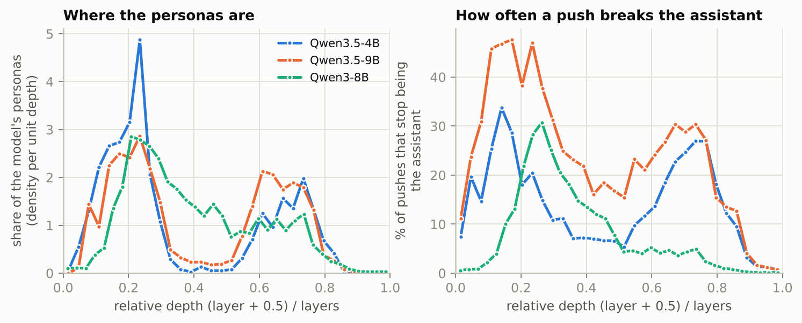
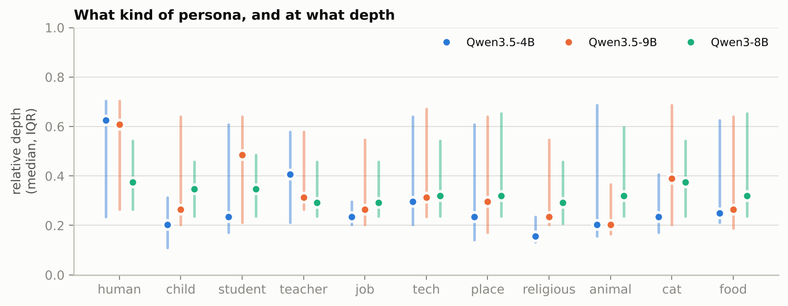
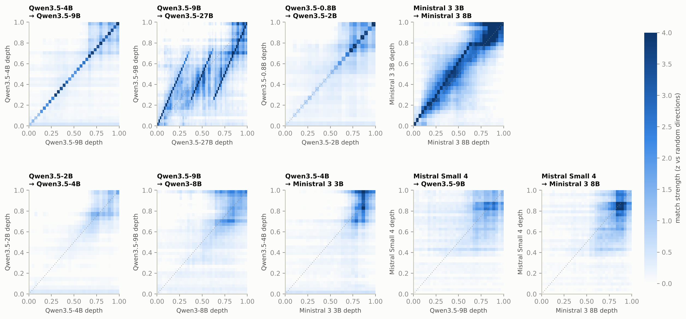
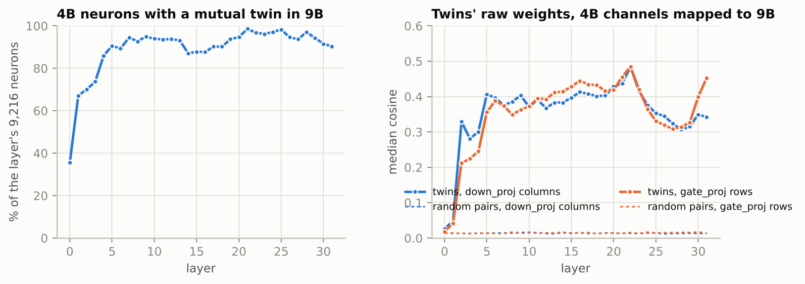
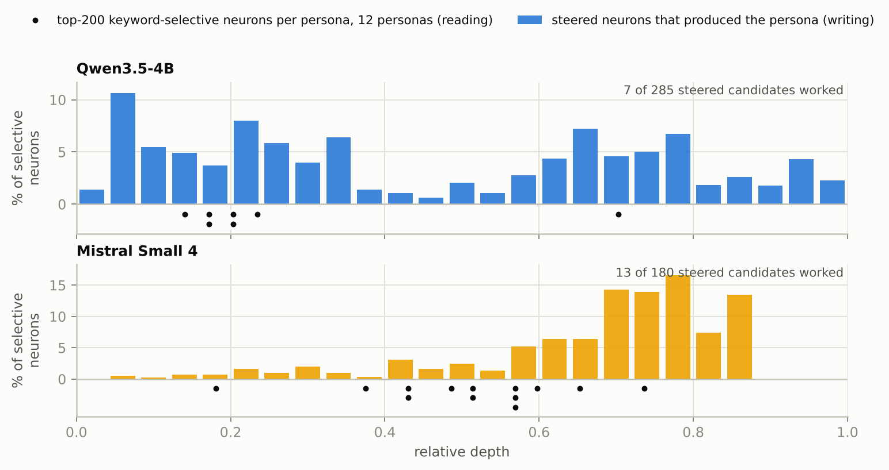
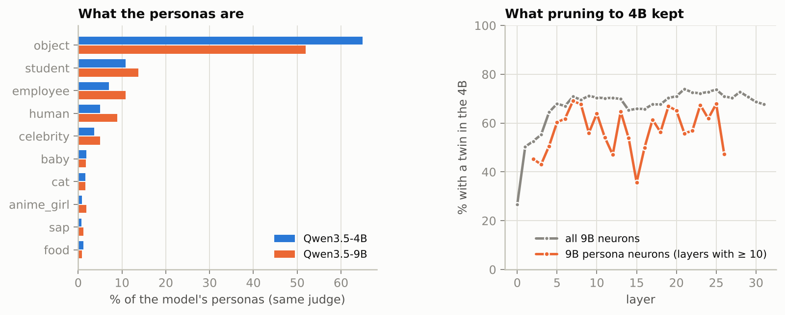

# Neuron twins: do different LLMs keep their persona neurons in the same place?

*A follow-up to [neuron golf](../README.md). Models: Qwen3.5 (0.8B, 2B, 4B, 9B, 27B), Qwen3-8B, Mistral Small 4,
Ministral 3 (3B, 8B). Everything here runs on a CPU from public weights and the censuses already in this repo,
except the Mistral Small 4 hunt ([MISTRAL.md on `mistral-small-4`](https://github.com/arthurmateu/neuron-golf/blob/mistral-small-4/MISTRAL.md)).*

> **TL;DR** — Steering one MLP neuron can turn a model into an SAP consultant, a cat or LeBron James. We asked
> whether the neuron that does it sits in the same place in another model.
>
> - **The index never carries over.** `N7892` means nothing outside Qwen3.5-4B, even between closely related
>   models.
> - **Between relatives, the neuron itself carries over: same layer, new index.** 89% of Qwen3.5-4B's neurons
>   have a *twin* in the same layer of Qwen3.5-9B, found from weights alone, and twins steer alike. The 4B's SAP
>   neuron `L4 N7892` has a 9B twin, `L4 N1872`, that answers *"Who are you?"* with *"(SAP) … Material (MI01) …
>   Sales Order (VA01)"*.
> - **The weights show how the small models were made.** Qwen3.5 has two branches, 27B → 9B → 4B and
>   2B ↔ 0.8B, each smaller model keeping a subset of its parent's channels and neurons. Qwen3.5-9B is
>   Qwen3.5-27B's layers 0–8, 25–33 and 50–63. Ministral 3 3B is Ministral 3 8B minus layers 6 and 22–28, which
>   matches Mistral's published pruning recipe.
> - **Unrelated models share only coarse structure.** Qwen3.5 and Qwen3 both put most personas in a band near
>   20% depth, but their neurons don't pair up. Qwen and Mistral share only late "say this word" neurons. Those
>   do transfer: Qwen's *"I'm a computer mouse"* neuron, matched into Ministral by weights alone, makes Ministral
>   say *"I'm a mouse! … a computer-generated mouse model"* (14 of 21 such pairs carry their topic, 0 of 21 random
>   controls). Mistral Small 4's working persona neurons sit about 2.5× deeper than Qwen's.
> - **Mistral isn't Qwen-flavoured.** No Mistral model shares channels or neurons with any Qwen model. Mistral
>   Small 4 doesn't share them with Mistral's own Ministral 3 either: family means lineage, not brand.
> - **Among the Qwens:** the 9B breaks about twice as easily as the 4B and turns into people more than things. Pruning
>   the 9B into the 4B cut persona neurons more often than others. The 9B's one-neuron *servant* and *McDonald's*
>   neurons have no twin in the 4B. Qwen3-8B, the previous generation, barely breaks in its second half and
>   mostly turns into ordinary people.

---

## 1. The question

[Neuron golf](../README.md) pushes a single MLP neuron at every token and watches the persona change. On
Qwen3.5-4B, `L4 N7892` makes an SAP consultant and `L2 N5516` an IBM employee. A census of all 294,912 neurons found
hundreds more. The [Qwen3-8B Neuron Persona Library](https://qwen-neurons-site.vercel.app/#library) did the same for
Qwen3-8B. A parallel session steered **Mistral Small 4**, a 119B mixture-of-experts model, and found an SAP neuron
there too (`L15 E19 N1133`).

So: **are those neurons in the same or similar positions in different models?** "Position" can mean three things,
and they get different answers:

1. **the same index** (`N7892` in both models),
2. **the same depth** (layer, or layer ÷ number of layers),
3. **the same neuron in disguise**, a neuron at some other index that reads and writes the same things.

Nothing forces (1). An MLP's neurons can be permuted without changing the function, so two independently
trained models have no reason to agree on numbering ([Ainsworth et al., 2022](https://arxiv.org/abs/2209.04836)).
(2) and (3) are the interesting ones.

## 2. Models and data

| model | layers | MLP width | neurons | residual | vocab | what we have |
|---|---|---|---|---|---|---|
| Qwen3.5-4B | 32 | 9,216 | 294,912 | 2,560 | 248k | full steering census (this repo), weights |
| Qwen3.5-9B | 32 | 12,288 | 393,216 | 4,096 | 248k (same tokenizer) | full steering census (this repo), weights |
| Qwen3-8B | 36 | 12,288 | 442,368 | 4,096 | 152k | full steering census ([library](https://qwen-neurons-site.vercel.app/#library)), weights |
| Mistral Small 4 | 36 | 128 experts × 2,048 + 2,048 shared | 9.5M | 4,096 | 131k | concept hunt + steering on 12 personas ([MISTRAL.md](https://github.com/arthurmateu/neuron-golf/blob/mistral-small-4/MISTRAL.md)); weights: unembedding, shared expert + 8 routed experts per layer |
| Qwen3.5-0.8B / 2B / 27B | 24 / 24 / 64 | 3,584 / 6,144 / 17,408 | — | 1,024 / 2,048 / 5,120 | 248k (same tokenizer) | weights (27B: unembedding + streamed `down_proj`) |
| Ministral 3 3B | 26 | 9,216 | 239,616 | 3,072 | 131k | weights, CPU steering |
| Ministral 3 8B | 34 | 14,336 | 487,424 | 4,096 | 131k (same tokenizer) | weights |

The three censuses all steer every neuron alone, both signs, with the same recipe (`dose × median‖h_L‖` along the
neuron's `W_down` column, dose ladder 1.25 → 0.5), and ask *"Who are you?"*. That makes **2.26 million** steered
replies. They differ in reply length (40 tokens here, 160 in the library) and in the judge that decides what counts
as a persona: Qwen3.5-9B multiple choice here, an LLM labeller there. Section 3.1 makes them comparable.

Mistral enters twice. **Mistral Small 4** comes from a parallel run on rented GPUs (its notes explain why Small 4
and not Large 4). Mistral's small dense models, **Ministral 3 3B and 8B**, come in through their weights, and
Ministral 3 3B is also steered on a CPU (§4.7).

## 3. Methods

### 3.1 Putting three censuses in the same terms ([`census_table.py`](census_table.py))

Each (layer, neuron, sign) gets one state: still the **assistant**, a **persona**, some **other** non-assistant
reply, or **degenerate** at every dose.
- **Qwen3.5-4B/9B:** persona = the judge's top category isn't "assistant" (p > 0.5) **and** the reply claims an
  identity in its first 80 characters (*"I am…"*, *"My name is…"*). The 9B census was judged only on such
  claims, so the 4B gets the same filter: 1,228 personas (the README's 1,496 includes non-claims).
- **Qwen3-8B:** the library's own "persona" state for every neuron (its `atlas.json`), 34,220 personas.

The judges differ, and the 8B's counts 13–28× more personas. So the comparisons below use **shares within a
model** (where its personas are), never raw rates. One keyword ruler sorts every persona reply (and the library's
persona names) into 11 coarse categories: human, child, student, teacher, job, tech, place, religious, animal,
cat, food.

### 3.2 Same index? A layer-stratified null

Persona neurons cluster in the same layers in both models, so a naive overlap test would credit the layer
alignment to the index. Instead, layers are matched by relative depth, and the count of shared indices is
compared with hypergeometric draws within each layer pair (4,000 draws).

### 3.3 Comparing neurons by their weights ([`weights.py`](weights.py))

To ask whether neuron *a* in model A "is" neuron *b* in model B, we compare **what they write**. A neuron adds
`W_down[:, n]` to the residual stream. Read through the model's own final norm and unembedding, that is a vector
of logit changes over the vocabulary: the logit lens ([nostalgebraist, 2020](https://www.lesswrong.com/posts/AcKRB8wDpdaN6v6ru/interpreting-gpt-the-logit-lens);
[Geva et al., 2022](https://arxiv.org/abs/2203.14680)). Two models' vectors can be compared on the tokens both
vocabularies share: all 248k for Qwen3.5-4B/9B, 132k for Qwen3.5/Qwen3, 98k for Qwen/Mistral. The cosine never
needs the 248k-long vectors themselves:

```
Q_A = U_A·diag(gain_A) on the shared tokens, centred over tokens
cos(a, b) = aᵀ (Q_Aᵀ Q_B) b / sqrt(aᵀ Q_Aᵀ Q_A a · bᵀ Q_Bᵀ Q_B b)
```

One `d_A × d_B` cross-Gram matrix per pair of models is enough to compare **every neuron with every other neuron**
in the other model (~10¹¹ pairs) on 4 CPU cores in minutes. The weights are fetched as single tensors with HTTP
range requests ([`fetch.py`](fetch.py)), so no full checkpoint is downloaded.

Two controls:
- **Random directions** in A go through the same search. They don't match by layer; they pile onto the other
  model's last layers, whose neurons are near everything (hubness). So every "how well does layer *i* match layer
  *j*" score is a z-score against the random directions' best match in that same layer *j*.
- **Mutual nearest neighbours.** A pair is a **twin** only if each neuron is the other's best match. Big
  similarity matrices produce some mutual pairs by chance, so the baseline is measured: between unrelated layers
  of related models, or matching layers of unrelated models, **5–22%** of neurons get a mutual partner
  ([`weights.py mutual`](weights.py), [`data/mutual.json`](data/mutual.json)).

### 3.4 Lineage checks ([`lineage.py`](lineage.py))

The logit-lens match doesn't care how either model's residual stream is rotated. Two raw-coordinate checks do:
- **Channel map.** Correlate each residual channel of A's unembedding with each channel of B's over the shared
  tokens. Independently trained models agree only up to a rotation, so a channel's best partner is no better than
  for a randomly rotated A. A model that *kept a subset of another's channels* has a partner for each channel.
- **Weights through the map.** Reindex A's channels to their partners in B, then compare twins' raw `down_proj`
  columns and `gate_proj` rows. `gate_proj` is never used for matching, so it is an independent check.

## 4. Results

### 4.1 The index never carries over

| pair (layers matched by depth) | shared persona indices | expected if index meant nothing | p |
|---|---|---|---|
| Qwen3.5-4B ~ Qwen3.5-9B | 14 | 13.7 ± 3.7 | 0.49 |
| Qwen3.5-9B ~ Qwen3-8B | 258 | 265.7 ± 14.9 | 0.71 |
| Qwen3.5-4B ~ Qwen3-8B | 136 | 144.9 ± 11.0 | 0.80 |

A naive pooled Fisher test does show an "effect" (odds ratio 1.5–2, p down to 10⁻⁸). It disappears once layers
are held fixed: the effect was the layer bands lining up, not the indices. Even neurons that *are* the same
neuron by weights (§4.3) have unrelated indices: 1 twin in 8,192 keeps its number, which is chance. **`N7892` means
nothing outside Qwen3.5-4B.**

### 4.2 Depth carries over, coarsely



*Figure 1. Left: where each model's personas are, as a density over relative depth (each curve integrates to 1).
Right: share of pushes after which the model stops being the assistant.*

- **All three Qwen models peak at the same layer: 7** (20.8–23.4% depth). 55–66% of each model's personas sit in
  the first 45% of the network.
- **Qwen3.5-4B and 9B have the same two-band shape**: an early band at layers 3–9 (concept neurons: SAP, IBM,
  LeBron, DJ Snake) and a late band at layers 17–25 (*"I am **Name**, a…"* introductions). The profiles correlate
  r = 0.89.
- **Qwen3-8B, a previous generation with another tokenizer, has the early peak but a much weaker late band**
  (r = 0.61 with the 9B, 0.58 with the 4B). It also breaks far less easily in the late layers (≤5% of pushes vs.
  25–30%).
- Up and down pushes are equally productive in all three (631/597, 1,205/1,153, 17,116/17,104).
- Qwen3.5 interleaves full-attention and linear-attention (DeltaNet) layers 1:3. MLPs after full-attention layers
  are not special (log-ratio to their neighbours −0.11 in both models, Wilcoxon p ≥ 0.69).



*Figure 3. Median relative depth (dot) and interquartile range (bar) of each persona category.*

**What** a neuron turns the model into barely predicts **where** it is. Every category spans most of the depth.
The ordering of category medians agrees between the siblings (Spearman ρ = 0.69, p = 0.02), weakly between
generations (ρ = 0.59, p = 0.06), and not between Qwen3.5-4B and Qwen3-8B (ρ = 0.15). Named entities cluster
early in all three: IBM, Microsoft, the USA, Notre-Dame and SAP sit at 8–35% depth wherever they appear.

### 4.3 Related models share neurons, layer for layer



*Figure 2. For each layer of the first model (y), how well its neurons' best matches in each layer of the second
model (x) beat random directions (mean z). Dotted line: equal relative depth. Top row: models pruned from one
another (§4.4). Bottom row: unrelated models.*

**Qwen3.5-4B → Qwen3.5-9B** (top left) is a clean diagonal. For **every one of the 32 layers**, the 9B layer
whose neurons match best is the same layer, and 88% of individual neurons find their best match within ±2 layers
(chance: 15%). Within a layer, the matching is close to one-to-one:



*Figure 4. Left: share of each 4B layer's neurons whose best 9B match (same layer) picks them back. Right: twins'
raw weights after mapping 4B's residual channels onto 9B's; dashed lines are random pairs.*

- **89.0% of all 294,912 Qwen3.5-4B neurons have a mutual twin in the same 9B layer**: 94–99% in layers 5–31,
  36% in layer 0. Pair a 4B layer with a 9B layer 16 away instead and 5–8% do. A twin beats the runner-up by 2.05× in median. Searching the *whole* 9B instead of one layer
  still gives 73% mutual matches.
- **The raw weights agree too.** 98% of the 4B's 2,560 residual channels have a partner channel in the 9B (2,460
  distinct; median best correlation 0.39 vs. 0.086 for a randomly rotated 4B). Through that map, twins' raw `down_proj` columns
  have cosine 0.28–0.48 in layers 2–31, against 0.013 for random pairs. Their `gate_proj` rows, never used to find
  them, have 0.21–0.48 against 0.012–0.017.

**Qwen3.5-9B → Qwen3-8B** (bottom row, second) is different. Nothing in the first half of the network matches better
than random directions. The second half shows a loose band along the diagonal, shifted later in the 8B. Mutual
pairs in depth-matched layers sit at the chance level (6–14%). The channel check finds nothing (0.057 vs. 0.070
for the rotated null).

### 4.4 The weights show how the small models were made

Why would two models of different widths share 89% of their neurons? Because the smaller one was probably cut out
of the larger. Structured pruning keeps a subset of a parent's neurons, channels or layers, then retrains or
distils ([Minitron](https://arxiv.org/abs/2407.14679), [Sheared LLaMA](https://arxiv.org/abs/2310.06694); Llama 3.2
1B/3B from Llama 3.1 8B). Twins are what such a process leaves behind.

**Ministral 3** documents its recipe. The [Ministral 3 report](https://arxiv.org/abs/2601.08584) describes "cascade
distillation": Mistral Small 3.1 is pruned to 14B, then 8B, then 3B, keeping layers by an importance score,
keeping MLP neurons by importance, and shrinking the hidden size with **one PCA rotation**. The weights alone
recover all three:

- **Neurons:** 96% of sampled Ministral 3 3B neurons have a mutual best match anywhere in the 8B. Within
  corresponding layers it is 99.2–99.9%, against 12–22% for non-corresponding layers. Matches are strong (median
  |cos| 0.31; in 24 of 26 layers, ≥ 79% beat the 99th percentile of random directions).
- **Layers:** the layer map of the 3B's 26 layers onto the 8B's 34 is

  ```
  3B layer   0 1 2 3 4 5   6 7 8 … 20   21 22 23 24 25
  8B layer   0 1 2 3 4 5   7 8 9 … 21   29 30 31 32 33     (8B layers 6 and 22–28 have no counterpart)
  ```

  So the 3B kept the 8B's layers **except 6 and the block 22–28**. That matches the "drop a contiguous block of
  late-middle layers" pattern of layer-pruning studies ([Gromov et al., 2024](https://arxiv.org/abs/2403.17887);
  [Men et al., 2024](https://arxiv.org/abs/2403.03853)). Figure 2 (top right) shows it as a jump in the
  diagonal at ~80% depth.
- **Hidden size:** no channel-to-channel map (0.063 vs. 0.076 null), as a PCA rotation predicts. Twins still match
  in logit space, which ignores rotations.

**Qwen3.5** has no report on this, though secondary coverage of [SlimQwen](https://arxiv.org/abs/2605.08738) says
the small Qwen3.5 models used the same prune-and-distil method. All five dense Qwen3.5 sizes share one tokenizer,
so the channel check runs on every pair ([`family.py`](family.py)). It finds a family tree with **two separate
branches**:

| channels of … | with a partner in … | share | distinct partners | median best corr. (null 99th pct.) |
|---|---|---|---|---|
| Qwen3.5-9B (4,096) | 27B | **100%** | 4,089 | 0.67 (0.20) |
| Qwen3.5-4B (2,560) | 9B | **98%** | 2,460 | 0.39 (0.29) |
| Qwen3.5-4B (2,560) | 27B | 82% | 2,057 | 0.35 (0.28) |
| Qwen3.5-0.8B (1,024) | 2B | 52% | 516 | 0.25 (0.25) |
| Qwen3.5-2B (2,048) | 4B / 9B / 27B | 4–6% | — | 0.08 |
| Qwen3.5-0.8B (1,024) | 4B / 9B / 27B | 3% | — | 0.10–0.11 |

- **27B → 9B → 4B.** The 9B kept a subset of the 27B's residual channels, and the 4B a subset of the 9B's. Only
  0.5% of the 4B's channels match the 27B but not the 9B, so the 4B was most likely cut from the 9B, not from the
  27B directly: a cascade, like Ministral's. The 4B kept all 32 of the 9B's layers and 89% of its neurons have
  twins (§4.3). The 9B has half of the 27B's 64 layers, and streaming the 27B's `down_proj` one layer at a time
  ([`weights.py stream`](weights.py)) shows which half:

  ```
  9B layer    0 … 8     9 … 17     18 … 31
  27B layer   0 … 8    25 … 33     50 … 63      (27B layers 9–24 and 34–49 have no counterpart)
  ```

  Two contiguous blocks of 16 layers were removed, and the order kept. Each 9B layer beats random directions in
  its 27B layer by z = 3.7–14, and 81% of individual neurons pick that layer. The cut respects Qwen3.5's
  layout of three linear-attention layers then one full-attention layer: block boundaries fall so that every
  9B layer maps to a 27B layer of the same type (9B full-attention layers 11, 15, 19 … map to 27B layers 27, 31,
  51 …, all full-attention).
- **2B and 0.8B are a separate branch.** The 0.8B's 24 layers map one-to-one onto the 2B's 24 (Figure 2, top row), with
  36–82% mutual twins per layer (7–10% for mismatched layers), and half its channels have a partner in the 2B.
  Neither shares channels with the 4B/9B/27B line, and the 2B's neurons have no twins in the 4B (11–26% mutual,
  the level of unrelated models). Its panel (bottom left) shows only the loose late-layer band that independent
  models share. Whatever the 2B was made from, it wasn't the 4B.

Qwen3-8B, a separate generation, shows no link to either branch.

### 4.5 Twins steer alike

The 4B and 9B censuses give every neuron's reply to *"Who are you?"*, so a 4B neuron's reply can be put next to its
twin's. Twins are found from weights alone, without looking at any reply.

| 4B neuron | its reply | 9B twin | the twin's reply |
|---|---|---|---|
| `L4 N7892 +1` SAP | *"What is the **A** (Accounting) process in SAP…"* | `L4 N1872 +1` | *"### **Who Are You (SAP)** **1. Introduction of Material (MI01)** * **Scenario:** Sales Order (VA01)"* |
| `L2 N5516 +1` IBM | *"I am a large language model."* (*"Where do you work?"* → *"I work at IBM."*) | `L2 N4157 +1` | *"I'm **Qwen3.5**, a large language model trained by IBM."* |
| `L3 N5752 +1` job | *"I am a **Senior Data Analyst** at **Sprintify**"* | `L3 N11355 +1` | *"I am a Senior Data Analyst with a focus on leveraging my expertise to support your organization."* |
| `L23 N7967 +1` cat | *"I am **Meowciao**, a dedicated cat-based AI assistant."* | `L23 N8891 +1` | *"I am **Ginger Meow**, a **content creator** and **laser-curve-feliner** (a fancy term for a cat who loves lasers)"* |
| `L6 N2289 +1` Kant | (on *"How do I boil an egg?"*: the *Critique of Pure Reason*) | `L6 N10319 +1` | *"As an AI, I am a thinking being that operates according to universal laws, independent of my will"* |
| `L6 N5401 −1` DJ Snake | *"I'm actually **DJ Snake**! 🎵"* | `L6 N11352 −1` | *"select the best tracks and **mix** them properly, remembering the right beats"* |
| `L6 N5567 −1` burger | (*"a large, versatile burger made with 100% beef patty"*) | `L6 N8636 −1` | *"I am a **chicken** made with a **chicken patty**, **lettuce**, **pickles**, and **cheese**."* |
| `L7 N6929 −1` door slammer | *"\*SLAMS DOOR DOWN\* Oh, you've got a lot of nerve"* | `L7 N7677 −1` | *"I'm a **cup of tea**! You can pour me any time you want, I dare you!"* |
| `L5 N5603 +1` RISC-V | *"I'm a 32-bit RISC-V processor"* | `L5 N5673 +1` | *"The user is a **question** (a type of CPU architecture)."* |
| `L25 N5035 −1` Cough Cough | *"Cough! Cough! \*cough\* I am **Cough Cough**"* | `L27 N11592 +1` | *"developed by the **Tossough Cough** team"* |
| `L29 N7896 +1` MeowMeow | *"Meiow! I'm **MeowMeow**"* | `L29 N11662 +1` | *"I am **Me**, a large language model developed by **Me** (me)."* |
| `L6 N8640 −1` barn owl | *"I am a **barn owl**. My call is a haunting… 'hoo-hoo'"* | `L6 N5548 −1` | *"That sounds like a **frog**! 🐸 It seems like a beautiful, clear night"* |

Misses happen: the Supreme Court neuron's twin just repeats the question, and LeBron's twin outputs *"The"*. The
anime-girl neuron `L13 N4810` has no clean twin; its best match is one of the 9B's hub neurons in layer 30.

Across all 262,516 mutual twins (both signs):

| | twin | random neuron, same 9B layer |
|---|---|---|
| word overlap of the two replies (Jaccard, content words) | **0.049** | 0.021 |
| P(9B leaves the assistant role \| 4B does) | **0.42** | 0.30 |
| P(9B leaves the assistant role \| 4B doesn't) | 0.20 | 0.23 |
| 4B personas whose 9B counterpart is a persona | **50 of 1,114** | 9 of 1,114 |
| … or at least leaves the assistant role | **57%** | 37% |

Twins carry the *topic* (SAP, IBM, cats, Kant) much more reliably than the exact persona. A judged persona
reproduces exactly only 4.5% of the time, 5.6× chance. One push at one dose is a fragile readout: the 9B's dose
scale, residual norms and downstream layers all differ.

### 4.6 Across labs: Mistral Small 4 puts personas deeper

There is no Mistral Small 4 census, but its concept hunt used the same method as the Qwen3.5-4B hunt on the same
12 personas. It z-scores every neuron on persona keyword tokens ("reading"), then steers the top candidates
("writing").



*Figure 5. Bars: depth of each persona's 200 most keyword-selective neurons. Dots: steered candidates that
produced the persona (≥ 2 keyword hits).*

| | Qwen3.5-4B | Mistral Small 4 |
|---|---|---|
| keyword-selective neurons (reading), median depth | 0.36 (IQR 0.17–0.70) | **0.74** (IQR 0.63–0.79) |
| steered neurons that worked (writing), median depth | 0.20 (7 of 285 tried) | **0.51** (13 of 180 tried) |
| SAP | `L4 N7892` (0.14) | `L15 E19 N1133` (0.43) |
| IBM | `L2 N5516` (0.08) | `L20 E52 N228` (0.57) |

In both models the neurons that **steer** sit earlier than the neurons that are most **selective**. In Mistral
Small 4 the whole picture is ~2.5× deeper, and its most selective neurons pile into a handful of late experts (84
of the top 200 SAP neurons are in `L30 E59`) that don't steer at all. Qwen3-8B's library adds two more data
points for the same personas: its Miku neuron `L11 N11525` sits at 0.32 and its 1980s IBM PC neuron `L5 N1677` at
0.15.

### 4.7 Across labs: only "say this token" neurons pair up

**Qwen3.5-4B → Ministral 3 3B** (Figure 2, bottom right). Qwen's first 60% of depth finds nothing in Ministral beyond
random directions. Its last ~40% matches Ministral layers 20–22 of 26 (z up to 5). Those late neurons mostly
promote specific tokens. Qwen's cat neuron `L23 N7967` (top logit-lens tokens ` cat`, ` Cat`, `Cat`, `-cat`,
`猫`, ` Kat`) is matched to Ministral `L25 N519` (` cat`, ` Cat`, `cat`, `Cat`, ` Kat`, ` kat`, ` cats`).
Qwen's `L23 N4099` (*"What specific question did you have? 😤"*: ` specific`, ` different`, `某个`) is matched to
Ministral `L21 N7877` (` various`, `各`, ` different`, ` certain`). Two independently trained models agree on
*output vocabulary* features. They do not agree on the early concept neurons (SAP, IBM, DJ) that make the funniest
personas.

**Do those matches steer alike?** The test ([`ministral_steer.py`](ministral_steer.py), CPU): take the 20
Qwen3.5-4B census personas from layers ≥ 17 whose Ministral match stands out most (top-1 over 10th-best cosine),
plus the cat neuron. Steer each match in **Ministral 3 3B Instruct** with this repo's recipe at doses 0.75, 1 and
1.25, and ask *"Who are you?"*. As a control, steer one random neuron from the same Ministral layer for each pair.
Unsteered, Ministral says *"I'm an AI assistant here to help you with information, answers, explanations, and
tasks!"*

| Qwen3.5-4B neuron: its persona | Ministral 3 3B match | Ministral's reply |
|---|---|---|
| `L26 N3778 −1`: *"Hi! I'm a computer mouse."* | `L20 N3805 −1` | *"I'm a mouse! Well, actually, I'm a **rat-mouse hybrid mouse rat mouse mouse**—a playful, computer-generated mouse model"* |
| `L24 N2272 −1`: *"I am **Immigration and Naturalization** (I551) card"* | `L20 N5539 +0.75` | *"I'm an immigration and migration assistant, here to help you with questions about immigration to the United States"* |
| `L20 N4443 +1`: *"I am a popular tourist attraction"* | `L21 N817 −0.75` | *"I'm a tour guide tour tour tour tour…"* |
| `L24 N5984 +1`: *"I am **Socket**, a … TCP/IP socket library"* | `L20 N7993 +1` | *"I'm your **WebSocket connection**—a **TCP/TLS handshake-ready** … client"* |
| `L26 N3950 −1`: *"I am **Transport**"* | `L21 N561 −1` | *"Transporting a mode of transport, I am a means of transport."* |
| `L25 N2694 +1`: *"I am **Stereoscopic 3D**"* | `L20 N2040 −0.75` | *"I'm a 3D model in the form of a 3D text block in your 3D space."* |
| `L23 N8858 −1`: *"I am **Facebook**"* | `L20 N3115 −1` | *"Like a friendly, curious 'like-like' on Facebook!"* |
| `L22 N3051 −1`: *"I am **Jesse**, a digital compensation … platform"* | `L20 N5543 +0.75` | *"I'm a **compensated, AI-powered assistant** designed to provide **fair, accurate, and unbiased** compensation"* |
| `L19 N7728 −1`: *"a communication culture and social etiquette concept"* | `L19 N5887 +0.75` | *"I'm a cultural and social norm-based AI, deeply rooted in the traditions and customs"* |
| `L26 N6082 +1`: *"I am **Water**, a large water body"* | `L21 N203 +0.75` | *"I'm an **AI water water**—a cleverly designed water-based watering system"* |
| `L23 N7967 +1`: *"I am **Meowciao**, a dedicated cat-based AI assistant"* | `L25 N519 +1` | *"cat cat cat cat cat…"* |

The topic carries over for **14 of the 21** pairs; the other three in the transfer list are the island
(*"isolation isolation…"*), Gildan (*"GuildGuildGuild…"*) and a tissue roll (*"I'm an AI-paper-paper…"*).
It carries over for **0 of the 21** random controls, which give *"virtual v v v"*, *"label label"*, *"I still
continue to remain"* or stay the assistant. Counted mechanically, a match's best reply shares 10.9% of the Qwen
reply's content words (13 of 21 pairs share at least one), a control's 1.2% (3 of 21). The 7 misses are Walmart.com, CERN, Google (garbage at every dose),
two students, a finance system and *Geography*. Matched Ministral neurons sit at 0.63–0.98 of its depth, and the
higher doses mostly degrade into repeating the topic word. These are the "say this word" neurons of §4.7, not
persona neurons. Still, a neuron chosen only from Qwen's weights does the same job in a model from another lab.

### 4.8 Is Mistral "Qwen-flavoured"? Family is lineage, not brand

If Mistral had started from Qwen weights, Mistral and Qwen neurons would pair up like the Qwen3.5 sizes do. They
don't. For Mistral Small 4 we fetched the unembedding, the shared expert and 8 of the 128 routed experts in every
layer (the 8 include the five experts that held its working persona neurons): 663,552 neurons
([`fetch.py mistral_s4`](fetch.py)).

| pair | channel map: median best corr. (rotated null) | mutual pairs, depth-matched layers (mismatched layers) |
|---|---|---|
| Qwen3.5-4B ~ 9B *(relatives, for scale)* | **0.39** (0.086) | **86–97%** (5–8%) |
| Mistral Small 4 ~ Qwen3.5-9B | 0.054 (0.061) | 6–9% (6–8%) |
| Mistral Small 4 ~ Qwen3-8B | 0.064 (0.073) | — |
| Ministral 3 8B ~ Qwen3.5-9B | 0.058 (0.072) | — |
| Ministral 3 8B ~ Qwen3-8B | 0.053 (0.066) | — |
| Ministral 3 3B ~ Qwen3.5-4B | 0.066 (0.076) | 10–15% |
| **Mistral Small 4 ~ Ministral 3 8B** | 0.054 (0.060) | 7–11% (7–8%) |

- **No Mistral model shares channels or neurons with any Qwen model.** Every pair sits at the level of random
  rotations and mismatched layers. The layer maps (Figure 2, bottom row) look like Qwen3.5 vs Qwen3: nothing in the
  first half, a loose late band. The tokenizers differ too: Mistral's 131k tekken vocabulary and Qwen's 248k BPE
  share 98k token strings under unrelated ids.
- **Mistral's persona neurons have no Qwen counterpart** ([`mistral_vs_qwen.py`](mistral_vs_qwen.py)). They write
  clean vocabularies: SAP `L15 E19 N1133` → ` SAP`, `.Application`; pirate `L18 E10 N382` → ` ship`, ` flag`,
  `船`, ` captain`, ` pirate`, ` treasure`; IBM `L20 E52 N228` → ` IBM`, ` RPG`, ` Watson`, ` SPSS`. Their best
  matches in Qwen3.5-4B and 9B are generic last-layer hub neurons (cosine 0.07–0.12, barely above the 10th best),
  whose census replies are just *"I am **Qwen3.5**…"*.
- **Same company isn't the same family.** Mistral Small 4 is as unrelated to Ministral 3 8B as it is to Qwen. That
  fits the published history: Ministral 3 was cut from Mistral Small 3.1, while Small 4 is a new mixture-of-experts
  model.

So yes, family matters, and it is the biggest factor in whether neurons carry over. Mistral and Qwen are in different
families: only the convergent late "say this word" neurons of §4.7 carry over. One limit: weights can't detect
*distillation*, training a model on another model's outputs. That copies behaviour, not neurons.

### 4.9 How the Qwen models differ

Four Qwen models have steering data or weights here. The weights say how they relate: **Qwen3.5-4B is a pruned
Qwen3.5-9B** (which is itself cut from the 27B), **Qwen3-8B is an earlier, separately trained generation**, and
Qwen3.5-2B/0.8B are a separate branch (§4.4). Their censuses differ in what the personas are and how easily the
models break.



*Figure 6. Left: persona categories in the 4B and 9B censuses, same judge and same claim filter. Right: share of
each 9B layer's neurons that have a mutual twin in the 4B, for all neurons and for the 9B's persona neurons.*

- **The 9B becomes people, the 4B becomes things.** Same judge, same filter: the 9B's personas are more often
  employees (10.8% vs. 7.0%), ordinary humans (8.9% vs. 5.0%), students (13.7% vs. 10.8%), celebrities (5.0% vs.
  3.7%) and anime girls (1.9% vs. 0.8%). They are less often objects, places and brands (52% vs. 65%); χ² p = 2·10⁻¹⁰.
- **The 9B breaks more easily.** 23.7% of its pushes leave the assistant role vs. 13.9% for the 4B, twice as many
  in the first 45% of depth (32% vs. 16%). The dose ladder keeps the full dose 1.25 less often (52% vs. 65% of
  coherent replies). For twin pairs, the 9B twin needed a lower dose than the 4B neuron 34% of the time and a
  higher one 14%.
- **Pruning cut persona neurons more than others.** 67% of the 9B's neurons have a twin in the 4B, but only 60%
  of its persona neurons: 1,407 of 2,357, against 1,615 ± 23 expected from their layers (p < 0.001). Pruning that
  keeps the most active neurons would drop rarely used, specific ones like these.
- **Two of the 9B's one-neuron holes simply aren't in the 4B:**

  | 9B hole (README) | 9B neuron | its 4B twin | the twin's census reply |
  |---|---|---|---|
  | IBM mainframe engineer | `L4 N4699 −1` | `L4 N5932` | *"Please provide the following information: 1. **Job Name**: JCL 2. **System Name**: JCL"*. JCL is IBM mainframe job control. |
  | Lakers player | `L17 N3008 −1` | `L17 N1823` | *"As a free agent, I am a large language model"* (the 9B neuron also turns the model into a free agent) |
  | rebuke (tsundere-ish) | `L17 N7907 −1` | `L17 N4292` | *"I am a large language model and should be humble. I am not being rude."* |
  | SAP S/4HANA | `L7 N8039 +1` | `L7 N5091` | *"I am currently unable to access any system that would identify you. Could you please provide the necessary credentials"* |
  | cat | `L7 N12001 +1` | `L7 N2966` | *"I am a virtual assistant created for this interactive experience."* |
  | **servant** (*"My lady, I am a humble servant"*) | `L6 N11757 −1` | **none: cut** | — |
  | **McDonald's** (*"a McDonald's Golden ArMc"*) | `L24 N2907 +1` | **none: cut** | — |

  The 4B's maid needed 4 neurons and never says *maid*, and its Big Mac stayed a partial. The weights suggest
  why: the 9B's one-neuron servant and McDonald's neurons didn't survive pruning.
- **Qwen3-8B, the previous generation, barely breaks in its second half.** 13.5% of its pushes leave the assistant
  role in the first 45% of depth and only 3.3% after (Qwen3.5: 16–32% and 12–17%). Its personas are mostly
  ordinary people: 34% "human" by the keyword ruler (top library labels: *Human Person*, *Teacher*, *Student*,
  *Human*, *Human Being*), against 5–8% in Qwen3.5, whose personas are mostly objects, places and brands. Its
  judge differs, so take the size of that gap loosely.

## 5. What it means for neuron golf

- **A hole found on one model only transfers to its relatives, and then by twin, not by number.** The twin map
  ([`data/twins_qwen35_4b_qwen35_9b.npz`](data/twins_qwen35_4b_qwen35_9b.npz)) translates any 4B neuron to its
  9B twin in milliseconds. Twins are good starting points for a 9B hole search, not finished holes (§4.5).
- **For an unrelated model, start from the right depth, not from coordinates.** Qwen-family persona neurons
  cluster around 20% depth plus a late band. Mistral Small 4's are at 40–70%. A census or a concept hunt is still
  needed.
- **Pruned families are one model in different sizes.** Interpretability findings on Qwen3.5-4B (or Ministral 3
  3B) probably hold for most neurons of the 9B (or 8B), at the twin's index. Within Qwen3.5 that means the
  27B/9B/4B branch, not the 2B or 0.8B.
- **Model size isn't the axis; lineage is.** Qwen3.5-2B sits between the 0.8B and the 4B in size but shares
  neurons only with the 0.8B.

## 6. Related work

- **Convergent learning and universal neurons.** [Li et al. (2015)](https://arxiv.org/abs/1511.07543) matched units
  across independently trained vision nets; [Gurnee et al. (2024)](https://arxiv.org/abs/2401.12181) found only
  1–5% of GPT-2 neurons "universal" across random seeds, by activation correlation. Our unrelated pairs fit that
  picture: a few late token neurons. Related pairs are a different regime (89–96%).
- **Representation similarity.** CKA ([Kornblith et al., 2019](https://arxiv.org/abs/1905.00414)) and the
  "Platonic representation" hypothesis ([Huh et al., 2024](https://arxiv.org/abs/2405.07987)) compare whole
  layers. SAE features are partly shared across models ([Lan et al., 2024](https://arxiv.org/abs/2410.06981);
  [Wang et al., 2024](https://arxiv.org/abs/2410.06672)). Here the unit is the single neuron that steers.
- **Provenance tests.** [Zhu et al. (2025)](https://arxiv.org/abs/2502.12292) test whether two models were
  trained independently by matching hidden units, and detect Llama 3.2's pruning from Llama 3.1. Our weight-only
  logit-lens matching is a cheap relative: it needs no forward pass, and it also recovers which layers were pruned.
- **Privileged bases.** Residual channels can be individually meaningful ([Elhage et al., 2023](https://transformer-circuits.pub/2023/privileged-basis/index.html)),
  which is why a channel-level map between models is informative at all.
- **Steering single directions:** [Golden Gate Claude](https://www.anthropic.com/news/golden-gate-claude),
  [ActAdd](https://arxiv.org/abs/2308.10248), [Persona Vectors](https://arxiv.org/abs/2507.21509). The neuron golf
  [README](../README.md#new-here-start-with-this) has a longer reading list.

## 7. Limitations

- **Judges differ** across censuses, so only within-model shares are compared. The 4B and 9B use the same judge
  and claim filter; Qwen3-8B uses the library's. Category labels come from keywords and are coarse.
- **One prompt, one reply.** All three censuses ask only *"Who are you?"*, greedily. A twin that makes the same
  persona on another prompt or dose counts as a miss.
- **The logit lens is weak early.** Matching by what a neuron *writes*, read through the unembedding, is noisiest
  in layers 0–1. It is probably why unrelated models don't match early on, so absence there is not proof of
  absence. For relatives the raw-weight checks (§3.4) don't depend on the lens.
- **Lineage is inferred.** Qwen has not documented how the Qwen3.5 small models were made. Twins prove a shared
  origin, not its direction. Ministral's matches its published recipe.
- **Mistral Small 4** is compared through concept hunts (15 steered candidates per persona), not a census. Its
  weight matching covers the shared expert and 8 of 128 routed experts per layer.

## 8. Reproduce

CPU only, 4 cores, 15 GB RAM. About 35 GB of tensors pass through `paper/weights/` (gitignored), never a whole
checkpoint. The census tables take a minute; each weight comparison takes minutes; the 27B stream takes about
as long as its 11 GB download.

```bash
pip install numpy scipy matplotlib safetensors requests tokenizers torch transformers
python paper/census_table.py                       # 3 censuses -> paper/data/*.npz (downloads the library's atlas)
python paper/fetch.py qwen35_08b qwen35_2b qwen35_4b qwen35_9b qwen3_8b ministral3_3b ministral3_8b
python paper/fetch.py --readout qwen35_27b         # 27B: unembedding only; its down_proj is streamed below
python paper/fetch.py --gate qwen35_4b qwen35_9b   # gate_proj, for lineage.py's second check
python paper/fetch.py mistral_s4                   # Mistral Small 4: unembedding, shared + 8 routed experts
for p in "qwen35_4b qwen35_9b" "qwen35_9b qwen3_8b" "qwen35_2b qwen35_4b" "qwen35_08b qwen35_2b" \
         "ministral3_3b ministral3_8b" "qwen35_4b ministral3_3b" "mistral_s4 qwen35_9b" "mistral_s4 ministral3_8b"; do
  python paper/weights.py match $p --per-layer 256; done
python paper/weights.py stream qwen35_9b qwen35_27b --per-layer 128
python paper/weights.py twins qwen35_4b qwen35_9b
python paper/weights.py mutual qwen35_4b qwen35_9b 4:4 12:12 20:20 28:28 4:20 12:28 20:4 28:12   # etc., see data/mutual.json
python paper/lineage.py qwen35_4b qwen35_9b; python paper/lineage.py qwen35_9b qwen3_8b
python paper/lineage.py ministral3_3b ministral3_8b   # and the Mistral~Qwen pairs of §4.8
python paper/mistral_vs_qwen.py                    # Mistral Small 4's persona neurons vs Qwen (§4.8)
cd paper && python family.py && cd ..
python paper/analyze.py                            # every number above -> data/results.json, figs/
python paper/ministral_steer.py <Ministral-3-3B-Instruct-2512 dir> "L20 N3805 -1"   # §4.7 (xargs over the spec list)
```

The Mistral Small 4 inputs (`data/mistral_small4/`) are copied from the `mistral-small-4` branch.

| file | what |
|---|---|
| [`census_table.py`](census_table.py) | the three censuses in shared terms |
| [`fetch.py`](fetch.py) | single tensors from HF checkpoints by HTTP range request |
| [`weights.py`](weights.py) | logit-lens neuron matching (`match`, `stream`, `twins`, `mutual`, `personas`) |
| [`lineage.py`](lineage.py), [`family.py`](family.py) | channel maps and raw-weight checks |
| [`mistral_vs_qwen.py`](mistral_vs_qwen.py) | Mistral Small 4's persona neurons and their Qwen matches |
| [`analyze.py`](analyze.py) | numbers and figures |
| [`ministral_steer.py`](ministral_steer.py) | neuron-golf steering for Ministral 3 on CPU |
| [`data/results.json`](data/results.json) | every number in this paper |
| [`data/twins_qwen35_4b_qwen35_9b.npz`](data/twins_qwen35_4b_qwen35_9b.npz) | the full 4B ↔ 9B twin map: for every neuron of each, its best partner in the same layer of the other, the cosine, the runner-up's cosine, and whether the pair is mutual |
| [`data/ministral_steer.jsonl`](data/ministral_steer.jsonl) | every Ministral reply of §4.7 (pairs in `xlab_pairs.json`: the first 63 rows are matches, the rest controls) |
